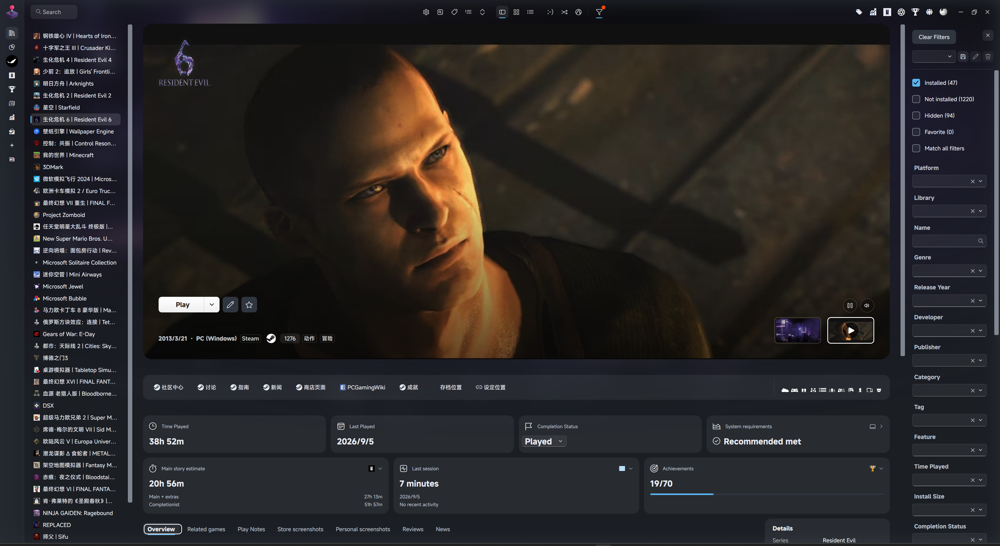
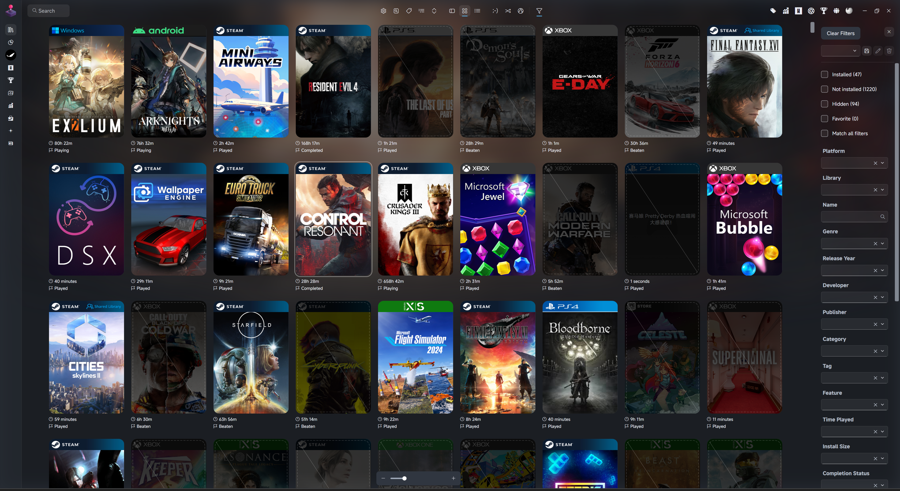
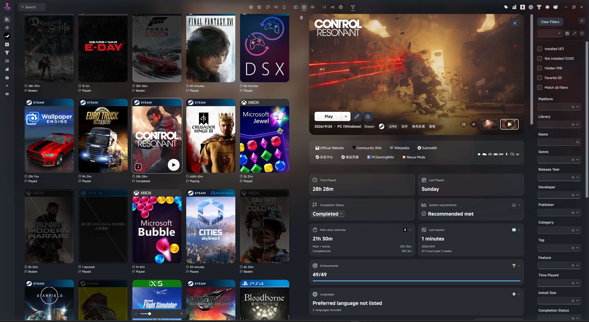
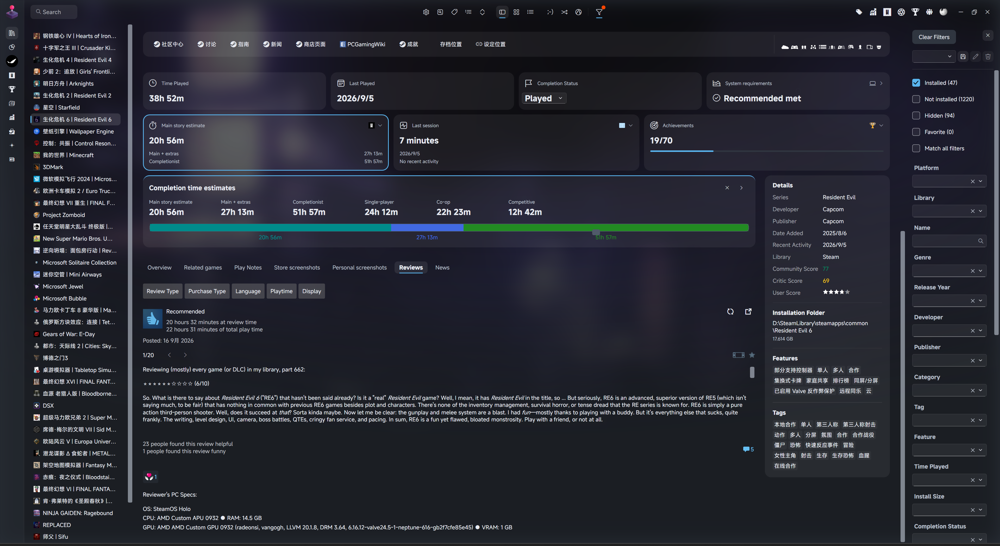
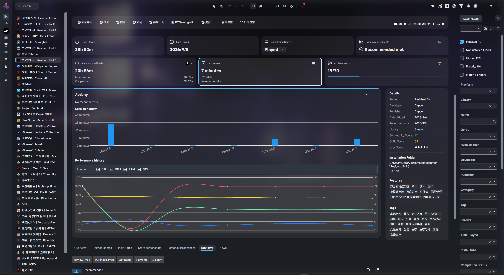
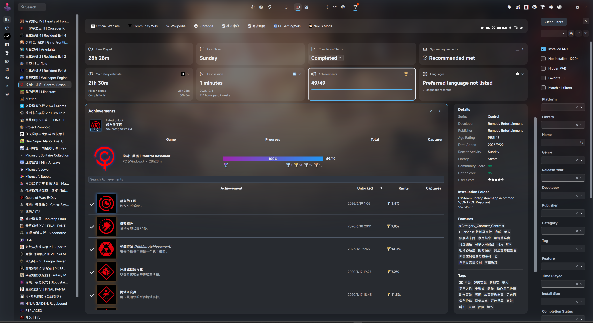
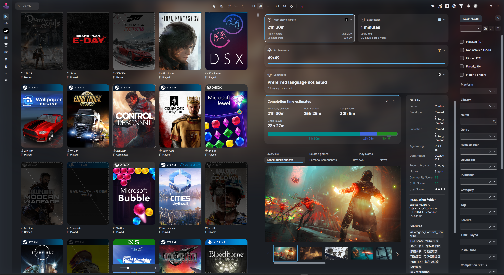

# Dune Rev

A dark, Fluent-inspired theme for Playnite Desktop.

English · [简体中文](README.zh-CN.md) · [Screenshots](#screenshots) · [Installation](#installation) · [Optional Extensions](#optional-extensions) · [Changelog](CHANGELOG.md)

> [!IMPORTANT]
> **Dune Rev 2.4.0** is a standalone stable release. Install the `.pthm` package and customize options with **ThemeModifier**; no extra helper extension is required. If you previously installed a **Dune Materials** preview extension, disable it before using 2.4.0. See the [2.4.0 release notes](docs/releases/v2.4.0.md) for details.

Based on [Dune](https://github.com/sakasakiking/Dune) by sakasakiking, Dune Rev pairs a low-glare dark interface with quick access to game information, media, and optional Playnite extensions.

## Features

- **Three library layouts** — Details, Grid, and Grid Details views with rounded surfaces, game logos (with title fallback when no logo is available), screenshots, and videos.
- **Built-in Hero media controls** — Manually switch between game backgrounds, Steam store screenshots, and videos right from the Hero area, with screenshot navigation, gallery access, and video play/pause/mute controls.
- **Proportional cover banners** — Edge-to-edge platform or store/source strips follow rounded cover corners and keep their proportions as cover width changes. PC games can prefer store/source banners while console and Playnite/manual games prefer platform banners, each independently toggleable.
- **Expandable summary cards** — View play time, completion status, achievements, completion estimates, activity, system requirements, language support, and DLC at a glance. Click supported plugin cards to expand details smoothly inline, or use dedicated buttons to open plugin windows.
- **Peer content tabs** — Overview, Related games, Play Notes, Store screenshots, Personal screenshots, Reviews, and News sit side by side as top-level tabs based on installed extensions and available game data. Empty related-game sections stay hidden.
- **Quieter cover controls** — Multi-copy selectors appear below covers on hover or keyboard focus and stay hidden for single-copy games. Play/details buttons support keyboard focus, with optional personal-score badges and reduced motion.
- **Consistent Fluent controls** — Unified spacing, rounded corners, hover/focus feedback, and dark translucent surfaces across menus, dropdowns, inputs, tables, tooltips, and supported plugin panels.
- **Flexible customization** — Adjust Hero size, blur and shading, layout widths, visible cards, panel heights, cover labels, motion preferences, and colors through **ThemeModifier**.

## Screenshots

*These captures show Dune Rev 2.3.0 with optional extensions and library metadata enabled. Your layout and visible panels depend on your installed extensions, theme settings, and game data.*

### Grid View

Rounded covers with platform or store banners, play time, and completion status.

### Grid Details View

Browse your cover grid alongside a game's Hero media, actions, and expandable plugin cards.

<strong>More screenshots: estimates, reviews, activity, achievements, and store screenshots</strong>

#### Completion Estimates & Steam Reviews

Expand a summary card while keeping content tabs accessible below it.

#### Activity & Recorded Performance

Session history and recorded CPU, GPU, memory, and FPS charts share the expanded activity panel.

#### Achievements

Latest unlock and the full achievement list appear in the expanded achievement panel.

#### Store Screenshots in Grid Details

Store screenshots have a dedicated tab with a bounded preview and selectable thumbnails.

## Installation

Requires **Playnite 10.57 or newer**. All extensions are optional.

### Option 1: Playnite Add-on Browser (Recommended)

1. Open Playnite Desktop and go to **Main Menu → Add-ons → Browse → Themes Desktop**.
2. Search for **Dune Rev** and click **Install** (or open the [Playnite add-on page](https://playnite.link/addons.html#DuneRev_aa8df0f9-9406-4ea6-a31a-3bd13853fd40)).
3. Select **Dune Rev** in Playnite's Desktop theme settings and restart Playnite.

### Option 2: Manual `.pthm` Package

1. Download the latest `.pthm` file from [GitHub Releases](https://github.com/hugsyf/dune-rev/releases/latest).
2. Double-click the `.pthm` file to install it into Playnite.
3. Select **Dune Rev** in Playnite's Desktop theme settings and restart Playnite.

After installing the theme, add any optional extensions you want from Playnite's Add-on browser and enable their theme integrations in each extension's settings.

## Optional Extensions

Install only the features you want. Dune Rev displays data provided by these extensions and works cleanly without them. Every extension below can be installed by name from Playnite's built-in **Add-ons** browser.

### Recommended Core

| Extension | What it adds |
| --- | --- |
| [ThemeModifier](https://github.com/Lacro59/playnite-thememodifier-plugin) | Layout, visibility, motion, and color settings for Dune Rev |
| [ThemeExtras](https://github.com/felixkmh/ThemeExtras-for-Playnite) | Favorites, completion-status/rating editing, banner overrides, and top-bar settings shortcut |
| [Extra Metadata Loader](https://github.com/darklinkpower/PlayniteExtensionsCollection/wiki/Extra-Metadata-Loader) | Game logos and videos |

### Game Info & Stats

| Extension | What it adds |
| --- | --- |
| [Playnite Achievements](https://github.com/justin-delano/PlayniteAchievements) | Achievement progress, latest unlock (requires 4.0+), and achievement list |
| [HowLongToBeat](https://github.com/Lacro59/playnite-howlongtobeat-plugin) | Completion time estimates and progress |
| [GameActivity](https://github.com/Lacro59/playnite-gameactivity-plugin) | Last session, recent activity, session history, and recorded performance charts |
| [SystemChecker](https://github.com/Lacro59/playnite-systemchecker-plugin) | System requirements status and hardware details |
| [CheckLocalizations](https://github.com/Lacro59/playnite-checklocalizations-plugin) | Preferred-language summary and interface/audio/subtitle support |
| [CheckDlc](https://github.com/Lacro59/playnite-checkdlc-plugin) | DLC counts, ownership, and all/owned/not-owned lists |

### Media, Community & Library

| Extension | What it adds |
| --- | --- |
| [BackgroundChanger](https://github.com/Lacro59/playnite-backgroundchanger-plugin) | Alternative game backgrounds |
| [Steam Store Screenshots Viewer](https://github.com/darklinkpower/PlayniteExtensionsCollection) | Store screenshot preview, thumbnails, Hero screenshots, and viewer commands |
| [ScreenshotsVisualizer](https://github.com/Lacro59/playnite-screenshotsvisualizer-plugin) | Personal screenshots and optional native grid gallery |
| [Play Notes](https://github.com/darklinkpower/PlayniteExtensionsCollection) | Dedicated notes tab with editing and import controls |
| [Game Relations](https://github.com/darklinkpower/PlayniteExtensionsCollection) | Same-series and similar games from your library |
| [Review Viewer](https://github.com/darklinkpower/PlayniteExtensionsCollection) | Steam user reviews and review filters |
| [Steam News and Players Viewer](https://github.com/darklinkpower/PlayniteExtensionsCollection) | Game news and current online player counts |
| [DuplicateHider](https://github.com/felixkmh/DuplicateHider) | Source selector for multiple copies of the same game |
| [Library Management](https://github.com/Lacro59/playnite-librarymanagement-plugin) | Feature icons |

> **Note:** Extensions linking to `darklinkpower/PlayniteExtensionsCollection` share one GitHub repository and can be installed individually by name in Playnite's Add-on browser.

## Customization

Install **ThemeModifier** to configure Dune Rev. Installing **ThemeExtras** as well unlocks the top-bar shortcut that opens theme settings directly.

| Settings group | Main controls |
| --- | --- |
| Global layout | Top bar height, compact Hero, Hero blur/shading, interface & cover motion, logo/title fallback, and settings shortcut |
| Details View layout | Content and information-column widths and game logos |
| Grid View layout | Details-pane width and logo size |
| Summary and extension content | Summary cards, detailed summaries, latest achievement, language support, and DLC details |
| Extension panels | Notes, related games, screenshots, rating editing, and panel/chart heights |
| Grid cover display | Cover banners, store/platform priorities, copy selector, score badges, rounded corners, and cover overlays |
| Colors | Window, card, popup, border, and icon colors |

**Built-in Hero media controls:** The theme includes manual switching between backgrounds, store screenshots (via **Steam Store Screenshots Viewer**), and videos (via **Extra Metadata Loader**). Screenshot controls provide previous, next, and open-gallery actions; video controls provide play, pause, and mute.

<strong>Key defaults in a fresh installation</strong>

| Option | Default |
| --- | --- |
| Platform/source cover banners | On |
| Prefer store/source banners for PC games | On |
| Prefer platform banners for Playnite/manual games | On |
| Multi-copy selector on hover/focus | On |
| Notes, related games, store & personal screenshot integrations | On, when available |
| Missing-logo title fallback & theme-settings shortcut | On, when available |
| Personal-rating editing through ThemeExtras | On, when available |
| Compact Hero & detailed summaries | Off |
| Reduce interface motion & reduce animated cover effects | Off |
| Personal-score badges on Grid covers | Off |
| Prefer ScreenshotsVisualizer native grid gallery | Off |
| Performance chart minimum height | 360 px |

<strong>Custom cover banners</strong>

Bundled platform and store artwork works out of the box without ThemeExtras. With **ThemeExtras** installed, you can also override banners and preserve your custom banner folder across theme updates.

Place custom PNG files in the installed theme's folders below, named after the matching identifier or exact name:

| Folder | Filename rule / example |
| --- | --- |
| `Images/Banners/PlatformSpecId` | `pc_windows.png` |
| `Images/Banners/PlatformName` | Exact platform name + `.png` |
| `Images/Banners/PluginId` | Library plugin GUID + `.png` |
| `Images/Banners/SourceName` | Exact source name + `.png` |

Restart Playnite after changing banner files. When a game has multiple platforms, the cover banner uses its first platform while the metadata row can still list all platforms.

## Companion Extension Status

Dune Rev 2.4.0 runs cleanly on its own. The optional **Dune Materials** companion extension (bringing realtime soft glass materials, continuous panel transitions, enhanced media previews, and automatic Hero playback) remains in development for a future release.

## FAQ & Feedback

- **A summary card or content tab is missing.**  
  Verify that the corresponding extension is installed, its theme integration is enabled in extension settings, the matching switch is enabled in ThemeModifier, and the selected game has data for it. (Play Notes also shows a prompt to create notes when none exist.)
- **Personal screenshot grid, language summary, or performance chart is empty.**  
  For the personal screenshot grid, enable the matching picture-list integration in **ScreenshotsVisualizer** and turn on the grid option in ThemeModifier. For language summaries, configure your preferred languages in **CheckLocalizations**. Performance charts require session performance data recorded by **GameActivity**.
- **I still use SuccessStory for achievements.**  
  Dune Rev 2.x integrates natively with **Playnite Achievements** (4.0 or newer for latest-unlock display). Users who prefer SuccessStory can use **Dune Rev 1.1.1**.
- **Found a bug or have a suggestion?**  
  Check the [Changelog](CHANGELOG.md) and open a report on [GitHub Issues](https://github.com/hugsyf/dune-rev/issues). Please include the active view, a screenshot, relevant extensions, and the Playnite log if the theme fails to load.

## Credits

- Based on [Dune](https://github.com/sakasakiking/Dune) by sakasakiking, with design inspiration from Mythic.
- Platform and store/source cover banner artwork comes from [KNARZnite](https://github.com/HerrKnarz/Playnite-Theme-KNARZnite); its MIT license and source revision are included with the banners.
- Distributed under the [MIT License](LICENSE).
