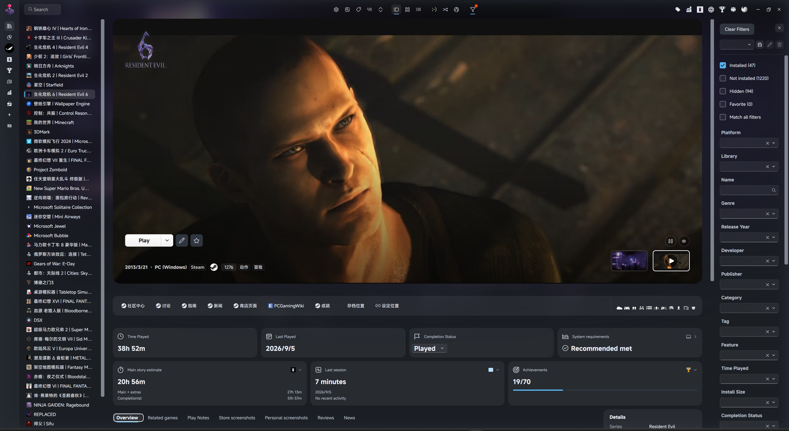
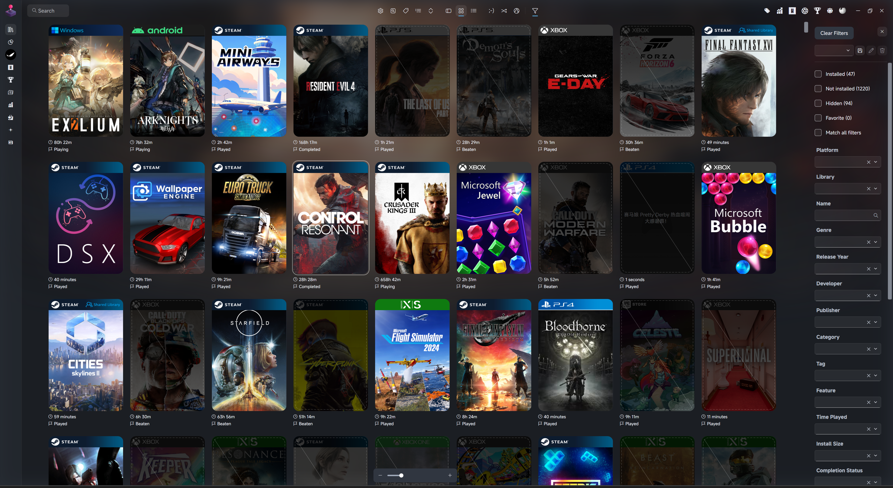
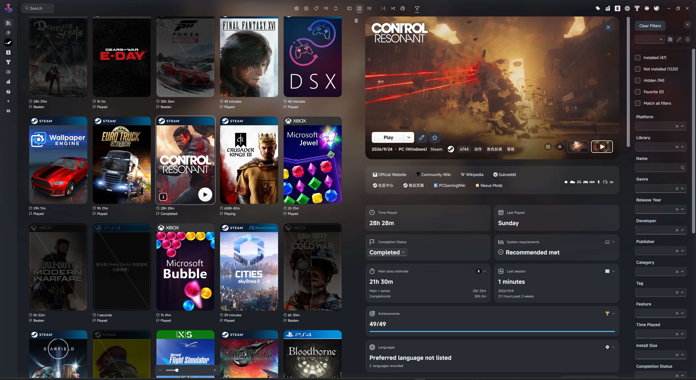
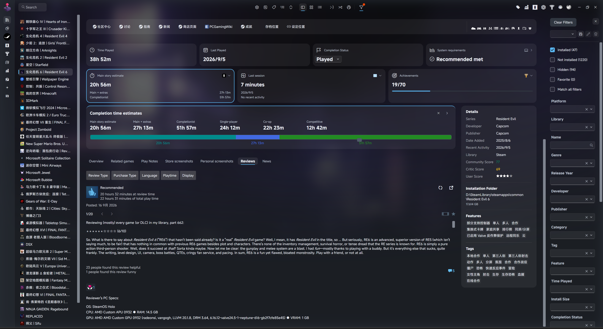
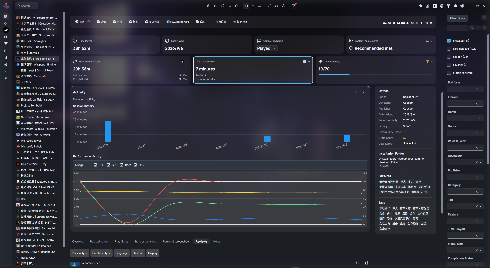
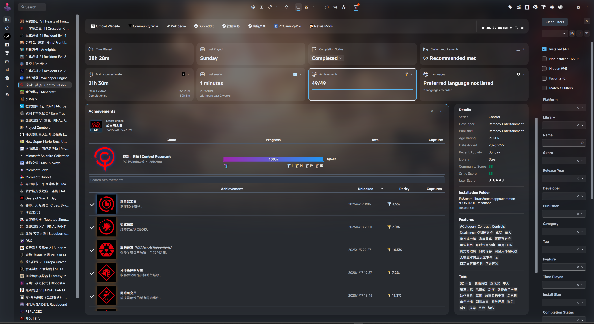
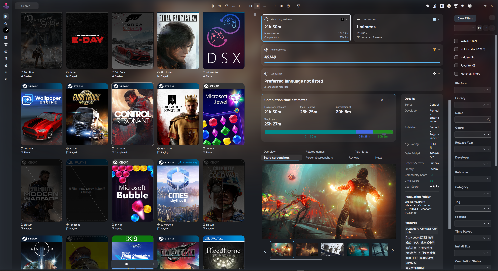

# Dune Rev

面向 Playnite 桌面模式的深色 Fluent 风格主题。

[English](README.md) · 简体中文 · [截图预览](#截图预览) · [安装](#安装) · [可选扩展](#可选扩展) · [更新日志](CHANGELOG.md)

> [!IMPORTANT]
> **Dune Rev 2.4.0** 为独立正式版，安装 `.pthm` 主题包并通过 **ThemeModifier** 调整选项即可使用，无需额外辅助扩展。此前安装过 **Dune Materials** 预览扩展的用户，请先停用该预览扩展再使用 2.4.0。详见 [2.4.0 更新与安装说明](docs/releases/v2.4.0.md)。

Dune Rev 基于 sakasakiking 的 [Dune](https://github.com/sakasakiking/Dune)，以低眩光的深色界面展示游戏库，并整合常用游戏信息、媒体内容与各类可选扩展。

## 主要特性

- **三种游戏库布局** — 支持详情、网格与网格详情视图，提供圆角界面、游戏 Logo（无 Logo 时可回退显示游戏标题）、截图与视频展示。
- **内置 Hero 媒体切换** — 可在 Hero 区域手动切换游戏背景、Steam 商店截图与视频，支持截图翻页、打开图库以及视频播放／暂停／静音。
- **等比例封面横幅** — 平台或商店／来源横幅贴合封面圆角，并随封面宽度等比例缩放。PC 游戏可优先显示商店／来源横幅，主机与 Playnite／手动添加的游戏可优先显示平台横幅，各项策略均可独立开关。
- **可展开的摘要卡片** — 集中呈现游玩时间、完成状态、成就、通关估时、活动记录、配置需求、语言支持与 DLC。点击支持的插件卡片即可就地展开详情，同时保留独立按钮用于打开插件窗口。
- **并列内容页签** — 总览、库内关联游戏、Play Notes、商店截图、个人截图、评论与新闻并列展示，按已安装扩展与当前游戏数据自动显示，关联游戏中无内容的分组自动隐藏。
- **更克制的封面交互** — 多副本来源选择在悬停或键盘聚焦时显示于封面下方，单副本游戏自动省略；游玩与详情操作支持键盘聚焦，并可选开启个人评分标记与减少封面动效。
- **统一 Fluent 控件** — 菜单、下拉框、输入框、表格、提示框及支持的插件面板采用统一的间距、圆角、悬停／焦点反馈与深色半透明表面。
- **灵活自定义** — 通过 **ThemeModifier** 调整 Hero 尺寸、模糊与暗化、布局宽度、摘要卡片、面板高度、封面标签、界面动效与配色。

## 截图预览

*以下实机截图基于 Dune Rev 2.3.0，包含可选扩展与游戏库元数据。实际布局与显示内容取决于已安装的扩展、主题设置和游戏数据。*

### 网格视图

圆角封面搭配平台／商店横幅、游玩时间与完成状态。

### 网格详情视图

浏览封面的同时，在右侧查看游戏 Hero 媒体、操作区与可展开的插件卡片。

<strong>更多截图：通关估时、评论、活动、成就与商店截图</strong>

#### 通关估时与 Steam 评论

摘要卡片展开后，下方的内容页签仍可直接切换使用。

#### 活动与性能记录

游玩历史与已记录的 CPU、GPU、内存和帧率图表共享活动展开区。

#### 成就

展开成就卡片后，可查看最近解锁成就与完整成就列表。

#### 网格详情中的商店截图

商店截图拥有独立页签，支持大图预览与缩略图切换。

## 安装

需要 **Playnite 10.57 或更新版本**。所有扩展均为可选。

### 方式一：通过 Playnite 附加组件浏览器安装（推荐）

1. 打开 Playnite 桌面模式，进入 **主菜单 → 附加组件 → 浏览 → 桌面主题**。
2. 搜索 **Dune Rev** 并点击 **安装**（也可直接访问 [Playnite 附加组件页面](https://playnite.link/addons.html#DuneRev_aa8df0f9-9406-4ea6-a31a-3bd13853fd40)）。
3. 在 Playnite 的桌面主题设置中选择 **Dune Rev**，然后重启 Playnite。

### 方式二：手动安装 `.pthm` 主题包

1. 前往 [GitHub Releases](https://github.com/hugsyf/dune-rev/releases/latest) 下载最新的 `.pthm` 文件。
2. 双击打开 `.pthm` 文件完成安装。
3. 在 Playnite 的桌面主题设置中选择 **Dune Rev**，然后重启 Playnite。

安装主题后，可按需在 Playnite 附加组件浏览器中安装下方扩展，并在对应扩展设置中启用主题集成。

## 可选扩展

按需安装即可。主题本身不抓取或记录扩展数据，未安装扩展时会自动隐藏对应区域。下列扩展均可在 Playnite 内置 **附加组件** 浏览器中按名称直接搜索安装。

### 推荐基础组合

| 扩展 | 提供的功能 |
| --- | --- |
| [ThemeModifier](https://github.com/Lacro59/playnite-thememodifier-plugin) | 调整主题布局、内容显示、动效与配色 |
| [ThemeExtras](https://github.com/felixkmh/ThemeExtras-for-Playnite) | 收藏、完成状态／个人评分编辑、横幅覆盖与顶栏设置快捷入口 |
| [Extra Metadata Loader](https://github.com/darklinkpower/PlayniteExtensionsCollection/wiki/Extra-Metadata-Loader) | 游戏 Logo 与视频 |

### 游玩数据与信息卡片

| 扩展 | 提供的功能 |
| --- | --- |
| [Playnite Achievements](https://github.com/justin-delano/PlayniteAchievements) | 成就进度、最近解锁（需要 4.0 或更新版本）与成就列表 |
| [HowLongToBeat](https://github.com/Lacro59/playnite-howlongtobeat-plugin) | 通关时间估时与进度 |
| [GameActivity](https://github.com/Lacro59/playnite-gameactivity-plugin) | 上次游玩、近期活动、游玩历史与性能记录图表 |
| [SystemChecker](https://github.com/Lacro59/playnite-systemchecker-plugin) | 系统配置需求检测与硬件详情 |
| [CheckLocalizations](https://github.com/Lacro59/playnite-checklocalizations-plugin) | 首选语言摘要及界面／语音／字幕支持情况 |
| [CheckDlc](https://github.com/Lacro59/playnite-checkdlc-plugin) | DLC 数量、拥有状态与全部／已拥有／未拥有列表 |

### 媒体、社区与库增强

| 扩展 | 提供的功能 |
| --- | --- |
| [BackgroundChanger](https://github.com/Lacro59/playnite-backgroundchanger-plugin) | 替代游戏背景 |
| [Steam Store Screenshots Viewer](https://github.com/darklinkpower/PlayniteExtensionsCollection) | 商店截图预览、缩略图、Hero 截图与查看操作 |
| [ScreenshotsVisualizer](https://github.com/Lacro59/playnite-screenshotsvisualizer-plugin) | 个人截图及可选的原生网格图库 |
| [Play Notes](https://github.com/darklinkpower/PlayniteExtensionsCollection) | 独立笔记页签，支持编辑与导入功能 |
| [Game Relations](https://github.com/darklinkpower/PlayniteExtensionsCollection) | 展示游戏库中的同系列与相似游戏 |
| [Review Viewer](https://github.com/darklinkpower/PlayniteExtensionsCollection) | Steam 玩家评论与筛选 |
| [Steam News and Players Viewer](https://github.com/darklinkpower/PlayniteExtensionsCollection) | 游戏新闻与当前在线人数 |
| [DuplicateHider](https://github.com/felixkmh/DuplicateHider) | 多副本游戏的来源选择 |
| [Library Management](https://github.com/Lacro59/playnite-librarymanagement-plugin) | 游戏特性图标 |

> **说明：** 指向 `darklinkpower/PlayniteExtensionsCollection` 的多个扩展托管在同一 GitHub 仓库中，可在 Playnite 附加组件浏览器里按各自名称单独安装。

## 自定义主题

安装 **ThemeModifier** 即可在 Playnite 中调整主题选项；同时安装 **ThemeExtras** 还可在顶栏启用主题设置快捷入口。

| 设置分组 | 主要选项 |
| --- | --- |
| 全局布局 | 顶栏高度、紧凑 Hero、背景模糊与暗化、界面／封面动效、缺 Logo 标题回退与设置入口 |
| 详情视图布局 | 内容区与信息栏宽度、游戏 Logo 显示 |
| 网格视图布局 | 详情栏宽度与 Logo 尺寸 |
| 摘要与扩展内容 | 摘要卡片开关、详细摘要、最近解锁成就、语言与 DLC 详情 |
| 扩展面板 | 笔记、关联游戏、截图、评分编辑与面板／图表高度 |
| 网格封面显示 | 封面横幅、商店／平台优先策略、多副本选择、评分标记、圆角与封面信息 |
| 配色 | 窗口底色、卡片、浮层、边框与图标颜色 |

**内置 Hero 媒体控制：** 主题支持在背景图、商店截图（需 **Steam Store Screenshots Viewer**）与视频（需 **Extra Metadata Loader**）之间手动切换。截图支持上一张、下一张和打开图库；视频支持播放、暂停与静音。

<strong>首次安装时的主要默认设置</strong>

| 选项 | 默认值 |
| --- | --- |
| 封面平台／来源横幅 | 开启 |
| PC 游戏优先显示商店／来源横幅 | 开启 |
| Playnite／手动添加游戏优先显示平台横幅 | 开启 |
| 悬停／聚焦时显示多副本选择 | 开启 |
| 笔记、关联游戏、商店与个人截图集成 | 开启（对应扩展可用时显示） |
| 缺 Logo 时显示标题与顶栏主题设置入口 | 开启（对应功能可用时显示） |
| 通过 ThemeExtras 编辑个人评分 | 开启（对应扩展可用时显示） |
| 紧凑 Hero 与详细摘要 | 关闭 |
| 减少界面动效与减少封面动效 | 关闭 |
| 网格封面个人评分标记 | 关闭 |
| 优先使用 ScreenshotsVisualizer 原生网格图库 | 关闭 |
| 性能图表最小高度 | 360 px |

<strong>自定义封面横幅</strong>

内置的平台／来源横幅无需 ThemeExtras 即可使用；安装 **ThemeExtras** 后，可提供额外横幅覆盖，并在更新主题时自动保留横幅文件夹。

将自定义 PNG 图片放入已安装主题的下列目录，并以对应的标识符或完整名称命名：

| 目录 | 文件名规则／示例 |
| --- | --- |
| `Images/Banners/PlatformSpecId` | `pc_windows.png` |
| `Images/Banners/PlatformName` | 完整平台名称 + `.png` |
| `Images/Banners/PluginId` | 库插件 GUID + `.png` |
| `Images/Banners/SourceName` | 完整来源名称 + `.png` |

修改图片后请重启 Playnite。当游戏包含多个平台时，封面横幅使用第一个平台，元数据行仍会列出全部平台。

## 配套扩展说明

Dune Rev 2.4.0 可独立完整运行。可选配套扩展 **Dune Materials**（提供实时玻璃材质、连续展开过渡、增强媒体预览与 Hero 自动播放等功能）仍在开发中，将在后续版本推出。

## 常见问题与反馈

- **某个摘要卡片或内容页签没有显示？**  
  请确认对应扩展已安装、已在扩展设置中启用主题集成、ThemeModifier 中的对应开关已打开，且当前选中的游戏确实存在相关数据。（Play Notes 在没有笔记时也会显示新建提示。）
- **个人截图网格、语言摘要或性能图表为空？**  
  使用个人截图网格需同时启用 **ScreenshotsVisualizer** 的图片列表集成和 ThemeModifier 中的网格图库选项；语言摘要需先在 **CheckLocalizations** 中设置首选语言；性能图表需要 **GameActivity** 已记录到游玩性能数据。
- **我仍在使用 SuccessStory 管理成就，该用哪个版本？**  
  Dune Rev 2.x 原生集成 **Playnite Achievements**（最近解锁展示需要 4.0 或更新版本）。继续使用 SuccessStory 的用户可以选择 **Dune Rev 1.1.1**。
- **遇到问题或有建议？**  
  版本变化请查看 [更新日志](CHANGELOG.md)。反馈问题请前往 [GitHub Issues](https://github.com/hugsyf/dune-rev/issues)，并附上所在视图、截图与相关扩展信息；若主题加载失败，请一并提供 Playnite 日志。

## 致谢与许可

- 基于 sakasakiking 的 [Dune](https://github.com/sakasakiking/Dune)，部分设计灵感来自 Mythic。
- 平台与商店／来源封面横幅素材来自 [KNARZnite](https://github.com/HerrKnarz/Playnite-Theme-KNARZnite)，其 MIT 许可证与来源版本随横幅文件一并附带。
- 本项目采用 [MIT 许可协议](LICENSE) 发布。
